# GATES ACT Adaptive Measurement for Longitudinal Neural Assays

**A group-disjoint evaluation of uncertainty-guided acquisition under explicit risk limits**  
Atharva Parande  
Technical Report 2026 01  
1 November 2026

<div class="abstract">

**Abstract.** Longitudinal neural microelectrode-array assays are commonly recorded on fixed dose-by-time schedules even when a subset of measurements may already determine the biological conclusion. Adaptive acquisition can reduce redundant measurement, but an acquisition model that reconstructs missing responses is not automatically safe to stop an experiment. We present GATES-ACT, a laboratory-constrained system that predicts unmeasured dose-time responses, selects the next physically eligible batch, protects biologically meaningful effects, and refuses decisions outside a calibrated evidence boundary. The final acquisition rule is conditional maximum posterior variance. It replaces a more elaborate effect-weighted score after external evaluation showed that the simpler rule had higher pooled protected recall and lower hidden-response error. Across 76 independent compound groups from three public neural-MEA sources, maximum variance achieved 97.87% protected effect recall, 0.334 hidden-response NRMSE, and 42.68% direct effect capture. Relative to fixed sentinels, recall improved by 2.46 percentage points (95% grouped-bootstrap interval 0.94 to 4.08; paired sign-flip p=0.00187); relative to random acquisition, it improved by 1.67 points (0.48 to 2.86; p=0.00318). NRMSE was significantly lower than every comparator. Early stopping did not survive external validation: three candidate stops included two unsafe outcomes, yielding a one-sided 95% upper risk bound of 98.3%. The released workflow therefore returns COMPLETE or ABSTAIN, claims zero physical-session savings, and requires at least 59 independent zero-failure validation stops before a 5% unsafe-stop limit could authorize STOP. Independent organ-on-chip and brain-organoid image studies further demonstrate that ranking performance does not guarantee calibrated automation under chronological or laboratory shift. GATES-ACT is consequently released as a high-recall acquisition and shadow-decision system, not an autonomous stopping system.

</div>

<div class="keywords">

**Keywords:** active measurement, microelectrode arrays, developmental neurotoxicity, Gaussian conditioning, conformal protection, distribution shift, abstention, sequential decision making

</div>

<div class="callout">
  <div class="metric"><strong>76</strong><span>external compound groups</span></div>
  <div class="metric"><strong>97.87%</strong><span>protected effect recall</span></div>
  <div class="metric"><strong>0.334</strong><span>hidden-response NRMSE</span></div>
  <div class="metric"><strong>0</strong><span>authorized early stops</span></div>
</div>

## 1 Introduction

Adaptive experimental design asks which observation should be acquired next. In longitudinal biology, that question is inseparable from physical eligibility, biological grouping, uncertainty calibration, and the consequence of a missed effect. A policy that chooses an informative dose on the current recording day may be useful even when it cannot safely terminate the remaining schedule. Conversely, a model with low average reconstruction error can still miss a rare compound-level effect or fail under a new laboratory source.

GATES-ACT addresses this distinction for neural microelectrode-array assays. Each experimental run forms a dose-by-time surface. At a scheduled recording day, the system observes a mandatory vehicle anchor and a restricted batch of eligible dose wells. It predicts the unobserved cells, updates posterior uncertainty after every within-batch selection, and tracks whether biologically meaningful effects remain protected. A separate release layer determines whether the result is sufficiently supported to complete, abstain, or eventually stop.

The project evolved through three evidence regimes. The initial organoid replay established that a small response surface could be reconstructed from sparse samples, but it did not demonstrate a policy-selected post-seed decision and its grid-cell reduction was not a laboratory-cost estimate. A second version introduced chronological neural-MEA replay, compound-disjoint splits, biological persistence, and whole-session accounting. The final evaluation expanded to 76 external compound groups across three public sources and forced two substantive reversals: the effect-weighted acquisition score was rejected in favor of conditional maximum variance, and early stopping was disabled after unsafe external outcomes.

This report makes five contributions:

1. a group-disjoint formulation of adaptive dose-time measurement with current-day eligibility and mandatory controls;
2. a robust posterior response model with conditional batch updates and an explicit comparison against fixed, random, geometric, and effect-weighted acquisition;
3. external evaluation on 76 compound groups from three public neural-MEA sources, with grouped uncertainty and source-stratified analysis;
4. a finite-sample release gate that separates acquisition quality from stopping authority; and
5. independent imaging stress tests that expose chronological calibration failure and cross-laboratory segmentation shift without asserting an unsupported multimodal relationship.

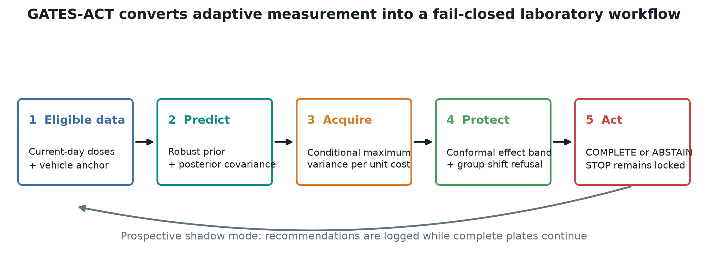

<p class="caption"><strong>Figure 1.</strong> End-to-end decision architecture. The acquisition loop uses only physically eligible measurements, while the release layer independently enforces effect protection, shift refusal, and stopping authorization. The feedback path represents prospective shadow logging rather than autonomous termination.</p>

## 2 Related methodological context

### 2.1 Active acquisition and matrix completion

Active matrix completion selects observations that reduce uncertainty in an incompletely observed response matrix. Kernelized approaches can exploit row-column geometry, while Gaussian-process methods provide posterior uncertainty over continuous inputs. These families motivate uncertainty-guided acquisition, but a generic matrix formulation does not automatically encode recording-day chronology, mandatory vehicle wells, compound-level split isolation, or the physical cost of an MEA session.

GATES-ACT treats dose rank and recording day as structural coordinates but evaluates policies inside a laboratory contract. The closest tested principles are conditional posterior variance, maximin geometric coverage, and expected integrated uncertainty reduction. The final choice is empirical: the system adopts the simplest policy that survives the frozen external comparison.

### 2.2 Selective prediction and refusal

Selective prediction permits a model to abstain when evidence is insufficient. In GATES-ACT, refusal is not a post-processing convenience. It is an operational state that prevents a shifted group from receiving an automated completion decision. Conformal effect bands are used to protect possible biological effects, while a group-shift score defines the familiarity boundary. These mechanisms are reported as conservative diagnostics; they do not establish arbitrary-shift guarantees.

### 2.3 Risk control for stopping

Stopping changes the experiment, so retrospective model accuracy is not a sufficient release criterion. The current framework uses an exact binomial upper bound on unsafe-stop risk. This is intentionally stricter than selecting a threshold that looks favorable on the same development groups. The rule can therefore reject an apparently efficient policy even when its reconstruction metrics remain strong.

### 2.4 Biological heterogeneity

Biological repeats, compound identities, laboratories, and acquisition dates create dependence that invalidates naive row-level splitting. GATES-ACT uses the highest biologically meaningful grouping level available for fitting, calibration, and resampling. Reported uncertainty is tied to compound groups rather than individual dose-time cells.

## 3 Problem formulation

For compound group (g), dose rank (d\in\mathcal{D}_g), and scheduled recording day (t\in\mathcal{T}_g), let (y_g(d,t)) denote the plate-matched vehicle-normalized neural response. At decision round (r), the observed set is (O_{g,r}\subseteq\mathcal{D}_g\times\mathcal{T}_g). The eligible set (E_{g,r}) contains only cells on the current recording day and always includes the required vehicle context. Future days are unavailable.

An affected cell is defined by the preregistered contrast threshold

$$
z_g(d,t)=\log(1+y_{\mathrm{treatment}})-\log(1+y_{\mathrm{vehicle}}),
\qquad |z_g(d,t)|\ge 0.40.
$$

The acquisition policy selects a batch (B_{g,r}\subseteq E_{g,r}). Four outcome families are tracked:

- **reconstruction:** NRMSE and MAE on cells hidden at the decision round;
- **effect protection:** recall and precision of the conformal affected-cell set;
- **direct discovery:** fraction of affected cells physically selected by the policy; and
- **release safety:** unsafe-stop rate and actual avoided whole recording sessions.

These outcomes are deliberately not collapsed into a single score. Direct capture rewards immediate discovery, NRMSE rewards surface reconstruction, and protected recall penalizes missed biological effects. A policy can improve one while degrading another.

### 3.1 Measurement cost

All policies allocate the same physical well plate. Selecting fewer analytical cells inside a recorded plate does not save wells or instrument sessions. A laboratory saving is counted only when an entire future recording session is prospectively authorized for omission. Because early stopping is disabled, the final reported physical-session saving is exactly zero.

### 3.2 Unsafe stop

A candidate stop is unsafe when subsequent complete data reveal a missed protected effect or unacceptable reconstruction under the frozen rule. Safety is assessed on proposed stops, not all runs. This conditional denominator is important: a policy that rarely proposes stopping can have high overall accuracy while still being unsafe whenever it acts.

## 4 Data sources and evidence design

### 4.1 Neural MEA sources

| Source | Endpoint | Independent groups | Role | Decision |
|---|---|---:|---|---|
| NTP EPA Phase 1 DNT MEA | Mean firing rate | 17 | held-out confirmation | Include |
| Brown neural ontogeny MEA | Mean firing rate | 6 | compatibility test | Include |
| EPA Tipping Point | Mean firing rate | 53 | largest shifted confirmation | Include |
| Vassallo acute MEA | Acute and baseline summaries | not pooled | order audit | Exclude |
| **Pooled external evidence** |  | **76** | group-weighted comparison |  |

The inclusion rule requires well-level neural electrophysiology, repeated chronological measurements, dose identity, matched control context, stable compound grouping, and a defensible measurement-cost unit. The Vassallo archive is hash-pinned but excluded because the processed release does not preserve a validated phase-resolved dose sequence. Pooling it would require inventing an acquisition order.

### 4.2 Group isolation

Compound identity is the atomic split boundary. Biological repeats, technical wells, doses, and all timepoints from a compound remain in one split. Vehicle normalization is plate matched. Replicates are aggregated only after normalization. Training groups estimate priors and kernels; calibration groups define conformal and shift quantities; external groups are never used to fit the final model.

### 4.3 Evidence evolution

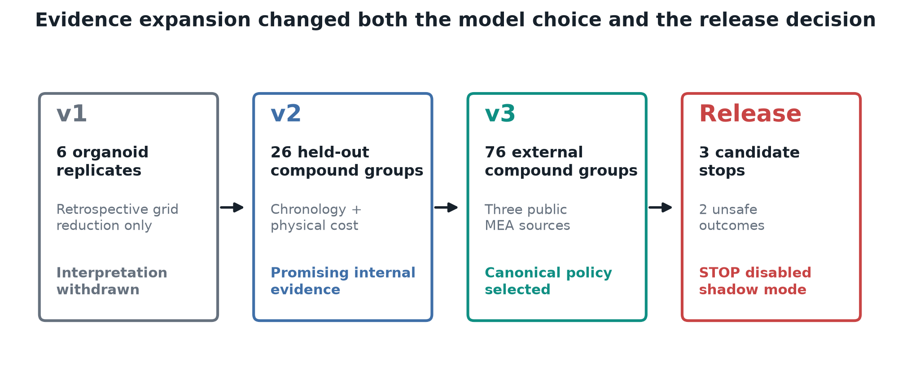

<p class="caption"><strong>Figure 2.</strong> Expansion of the evidence boundary. Each stage changed the scientific claim: v1 established sparse reconstruction, v2 introduced chronological and physical-cost constraints, v3 selected the canonical acquisition rule on external sources, and the release audit disabled stopping.</p>

The earlier six-replicate organoid result is retained for audit but not used as final evidence. Version 2 contributes development ablations and demonstrates why permissive persistence or refusal rules can generate unsafe stops. Version 3 supplies the external acquisition comparison. The release decision is based on candidate-stop outcomes across external sources, not the development study alone.

## 5 Probabilistic response model

### 5.1 Population prior and covariance

The model represents each dose-time surface with a robust population median and a shrinkage covariance. A structural Matern-like kernel encodes proximity in dose rank and recording day. A local biological-analog ensemble contributes a conservative covariance component from nearby training surfaces. Shrinkage stabilizes the small-group covariance estimate and prevents singular conditioning.

Let (mu\) be the population prior and (K\) the blended covariance over all surface cells. For observed indices (O), the posterior is

$$
\mu_{\mathrm{post}}=\mu+K_{:,O}(K_{O,O}+\sigma_n^2I)^{-1}(y_O-\mu_O),
$$

$$
K_{\mathrm{post}}=K-K_{:,O}(K_{O,O}+\sigma_n^2I)^{-1}K_{O,:}.
$$

The solve uses regularization, symmetry checks, and fail-closed numerical behavior. External outcomes never retune the kernel, neighbor count, analog weight, or noise fraction.

### 5.2 Conditional batch acquisition

The canonical score is posterior variance per unit measurement cost:

$$
s(c\mid O)=\frac{K_{\mathrm{post}}(c,c)}{\operatorname{cost}(c)},\qquad c\in E_r.
$$

After selecting a candidate, covariance is conditioned before the next member of the same batch is chosen. This fantasy update prevents a batch from repeatedly selecting mutually redundant cells. With equal costs, the rule reduces to conditional maximum variance.

### 5.3 Effect protection

For each hidden cell, a calibrated conformal width (q\) expands the posterior interval. A cell is protected whenever the interval can cross the absolute effect threshold. The rule is deliberately conservative. It raises recall at the cost of positive precision, especially under source shift.

### 5.4 Shift score and refusal

A Mahalanobis-style group score measures distance from calibration geometry. Groups beyond the frozen quantile receive ABSTAIN. The score is a familiarity diagnostic, not a universal out-of-distribution detector. Imaging experiments later show that plausible uncertainty scores can accept a shifted laboratory even when errors increase.

## 6 Acquisition policies and experimental controls

All policies use the same model, initial measurements, candidate set, batch size, vehicle requirement, chronology, and evaluation groups.

| Policy | Selection principle | Intended strength | Known limitation |
|---|---|---|---|
| Conditional maximum variance | Largest posterior variance per cost with batch conditioning | Global uncertainty reduction | May not directly target effects |
| Effect weighted | Variance reduction times effect probability plus direct bonus | Exploit likely effects | Depends on imprecise probabilities |
| Maximin | Largest minimum distance from observed cells | Geometric coverage | Ignores posterior scale |
| Random | Frozen random eligible sample | Procedural baseline | High variance |
| Fixed sentinels | Prespecified sparse dose panel | Reproducible baseline | Cannot adapt |

The effect-weighted policy was the intended research contribution. Its removal is therefore a substantive negative result. On the largest shifted confirmation it achieved 96.68% source-mean recall, while maximum variance achieved 98.01%. The direct-effect bonus increased pooled direct capture from 42.68% to 44.16%, but pooled recall and NRMSE both worsened.

## 7 Evaluation protocol

### 7.1 Frozen external evaluation

Each external run is replayed in chronological order. At each round, the policy receives only current and previous measurements. The same group-level metric record is computed for all five policies. Pooled metrics are group weighted across 76 compound identities.

### 7.2 Statistical comparisons

Paired differences are computed at the compound-group level. Confidence intervals use grouped bootstrap resampling. P values use paired sign-flip tests. The report treats an interval crossing zero as unresolved even if the pooled point estimate favors one policy. No correction is applied to reinterpret nonsignificant comparisons as wins.

### 7.3 Reproducibility controls

Source archives, split manifests, frozen traces, policy configurations, and stopping locks are hash-pinned. A focused verifier recomputes source boundaries, policy coverage, pooled metrics, paired comparisons, exact risk limits, and disabled-stop behavior. The imaging audit separately recomputes protected AUROC, average precision, Dice, area error, split isolation, and hashes.

## 8 Main acquisition results

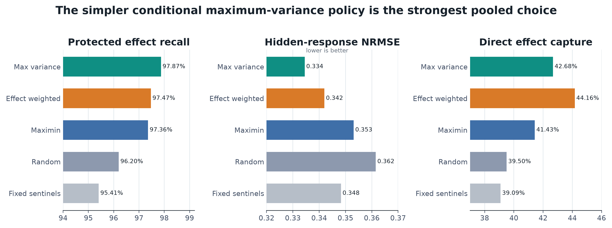

<p class="caption"><strong>Figure 3.</strong> Pooled group-weighted comparison across 76 compound groups. Maximum variance has the highest protected recall and lowest NRMSE. Effect-weighted acquisition has the highest direct capture, illustrating that direct discovery and global reconstruction are distinct objectives.</p>

| Policy | Protected recall | Effect precision | Hidden NRMSE | Direct capture |
|---|---:|---:|---:|---:|
| **Conditional maximum variance** | **97.87%** | 32.04% | **0.334** | 42.68% |
| Effect-weighted acquisition | 97.47% | 31.97% | 0.342 | **44.16%** |
| Maximin | 97.36% | 33.56% | 0.353 | 41.43% |
| Random | 96.20% | **35.96%** | 0.362 | 39.50% |
| Fixed sentinels | 95.41% | 35.44% | 0.348 | 39.09% |

Maximum variance is selected because it occupies the strongest pooled recall-error position. Its NRMSE is lower than effect weighted by 0.0075 (95% interval 0.00066 to 0.0152 in magnitude; p=0.0464), maximin by 0.0186 (p=0.0106), fixed sentinels by 0.0138 (p=0.0120), and random by 0.0270 (p<0.0001).

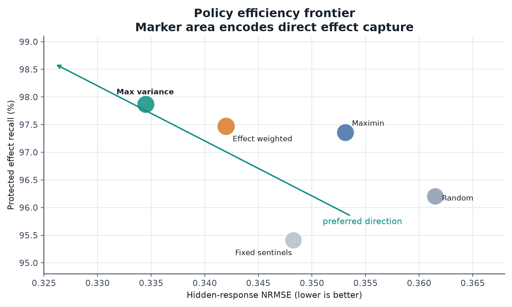

<p class="caption"><strong>Figure 4.</strong> Efficiency map combining protected recall, reconstruction error, and direct capture. The focused axes are disclosed and used to resolve policy differences rather than absolute magnitudes. Marker area is proportional to direct capture.</p>

The Pareto view explains why no single metric is sufficient. Effect weighted moves rightward because NRMSE increases, but its larger marker reflects improved direct capture. Maximin and random are dominated on the pooled recall-error plane. Fixed sentinels preserve reasonable NRMSE but have the lowest recall.

### 8.1 Paired uncertainty

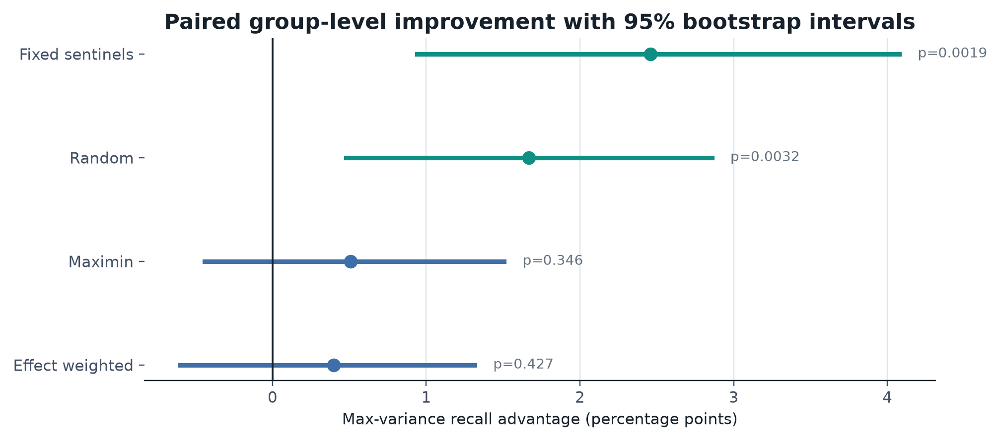

<p class="caption"><strong>Figure 5.</strong> Group-paired maximum-variance recall advantage with 95% bootstrap intervals. Positive intervals against fixed sentinels and random acquisition support a recall improvement. Intervals against maximin and effect weighted cross zero.</p>

The recall advantage over fixed sentinels is 2.46 points (0.94 to 4.08; p=0.00187), and the advantage over random is 1.67 points (0.48 to 2.86; p=0.00318). The difference from maximin is 0.51 points (-0.44 to 1.51; p=0.346), while the difference from effect weighted is 0.40 points (-0.60 to 1.32; p=0.427). The supported statement is therefore “best pooled choice with significant wins over fixed and random,” not “significantly superior to every baseline.”

## 9 Source-stratified results

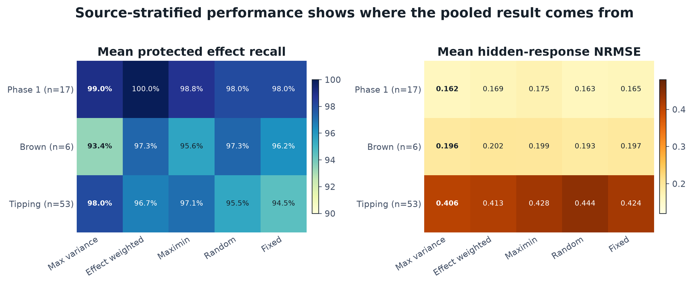

<p class="caption"><strong>Figure 6.</strong> Mean performance within each external source. The pooled decision is driven by the large Tipping confirmation, but the Brown compatibility set exhibits a different ordering. Sample sizes are compound groups.</p>

The NTP Phase 1 set is comparatively easy for effect protection: all policies exceed 98% mean recall. Effect weighted reaches 100% recall, while maximum variance has the lowest NRMSE at 0.162. The six-group Brown set is heterogeneous and small. Random has the lowest mean NRMSE (0.193), effect weighted has the highest recall (97.30%), and maximum variance reaches 93.36% recall. These differences are not used as evidence that random acquisition is generally preferable; they show that source-level rankings are unstable at small (n\).

The 53-group Tipping confirmation controls the external conclusion. Maximum variance achieves 98.01% recall and 0.406 NRMSE. Effect weighted reaches 96.68% and 0.413, maximin 97.09% and 0.428, random 95.49% and 0.444, and fixed sentinels 94.48% and 0.424. The maximum-variance advantage over effect weighted is therefore concentrated in the largest shifted source rather than uniformly distributed across all datasets.

## 10 Distributional and trajectory analysis

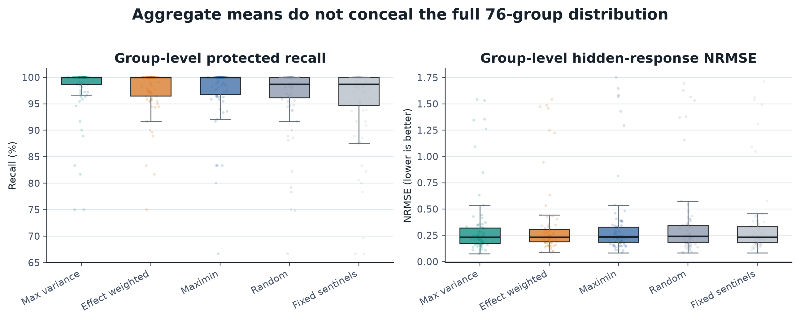

<p class="caption"><strong>Figure 7.</strong> Compound-group distributions for protected recall and NRMSE. Points show all 76 groups; boxes summarize median and interquartile range. This view prevents pooled means from hiding tail failures.</p>

Protected recall is ceiling concentrated for every policy, but the lower tail differs. Maximum variance reduces the number and severity of low-recall groups relative to fixed and random baselines. NRMSE has a wider source-driven distribution, with high-error groups concentrated in the Tipping set. The boxplots should not be interpreted as independent samples across policies because the same compounds appear in every box; paired inference is supplied separately in Figure 5.

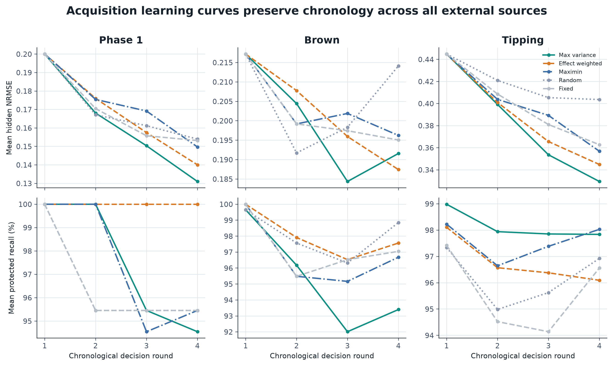

<p class="caption"><strong>Figure 8.</strong> Mean learning curves across chronological decision rounds for all external sources. The upper row tracks reconstruction error and the lower row tracks protected effect recall. All methods receive the same sequence of eligible recording days.</p>

The trajectory plots separate early-round behavior from final pooled metrics. Reconstruction generally improves as more measurements become available, but policy ordering can change by source and round. Recall remains high because conformal bands protect ambiguous cells even when positive precision is low. Conditional covariance updates are most useful when the eligible batch contains redundant doses; fixed and random policies do not exploit that redundancy structure.

### 10.1 Error structure

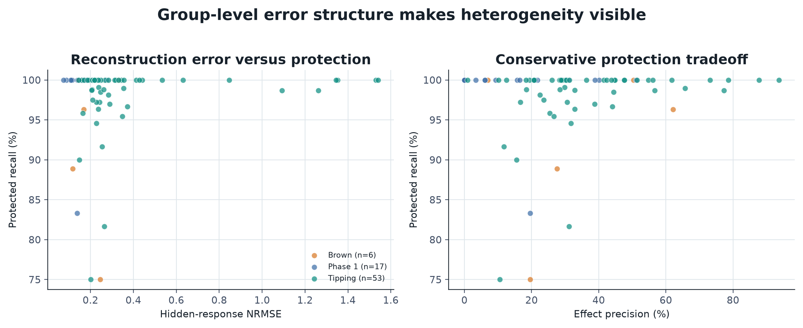

<p class="caption"><strong>Figure 9.</strong> Maximum-variance outcomes by compound group. Left: protected recall versus reconstruction error. Right: recall versus effect precision. Colors identify external source.</p>

High protected recall can coexist with high NRMSE because the effect-protection rule asks whether a cell might cross a biological threshold, whereas NRMSE measures continuous reconstruction quality. Precision decreases when intervals widen under shift. This is an intended asymmetry: the final system prioritizes avoiding false negatives over making a compact positive set.

## 11 Ablation analysis

Version 2 provides eight frozen development ablations that vary persistence, abstention, calibration tolerance, NRMSE target, and effect threshold. These are not pooled with v3 external results; they are used to diagnose which safeguards control candidate stopping.

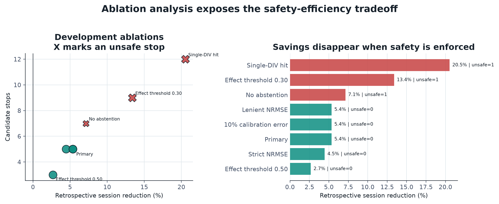

<p class="caption"><strong>Figure 10.</strong> Development ablations. Marker area in the left panel reflects abstentions; X markers indicate at least one unsafe stop. The right panel shows that the largest retrospective savings arise from rules that fail the zero-unsafe-stop condition.</p>

| Ablation | Candidate stops | Unsafe | Abstentions | Session reduction |
|---|---:|---:|---:|---:|
| Primary | 5 | 0 | 2 | 5.36% |
| Single DIV hit | 12 | 1 | 2 | 20.54% |
| No abstention | 7 | 1 | 0 | 7.14% |
| Allow 10% calibration error | 5 | 0 | 2 | 5.36% |
| Strict NRMSE 0.15 | 5 | 0 | 2 | 4.46% |
| Lenient NRMSE 0.25 | 5 | 0 | 2 | 5.36% |
| Effect threshold 0.30 | 9 | 1 | 2 | 13.39% |
| Effect threshold 0.50 | 3 | 0 | 2 | 2.68% |

Requiring effects to persist across at least two recording days is a material safeguard. The single-DIV rule more than triples retrospective savings but introduces an unsafe stop. Removing abstention also creates an unsafe outcome. Lowering the biological threshold to 0.30 increases candidate stops and savings while failing safety. These results explain why a favorable development operating point cannot authorize stopping on its own.

## 12 Stopping release analysis

If (x\) of (n\) independent validation stops are unsafe, the one-sided Clopper-Pearson upper bound at level (1-\alpha\) is

$$
U(n,x,\alpha)=F^{-1}_{\operatorname{Beta}(x+1,n-x)}(1-\alpha).
$$

STOP requires (U\le0.05\), an in-boundary shift score, acceptable reconstruction, protected biological effects, and evidence hashes matching the frozen configuration. Otherwise, a candidate stop becomes COMPLETE and a shifted group becomes ABSTAIN.

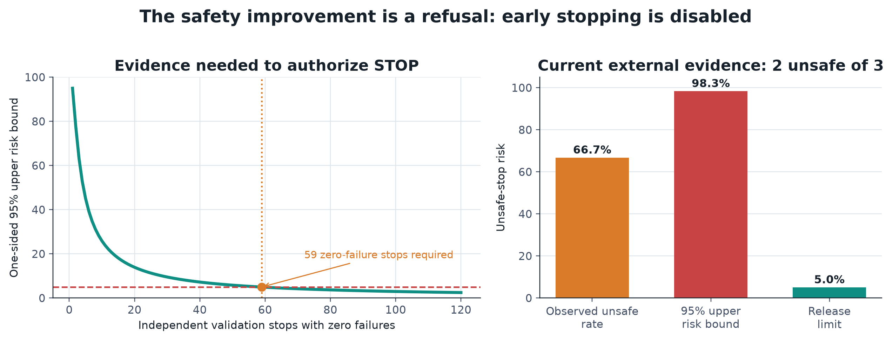

<p class="caption"><strong>Figure 11.</strong> Exact stopping evidence. Left: the minimum evidence needed when no failures are observed. Right: current external outcomes. Two unsafe outcomes among three proposed stops produce a 98.3% one-sided upper bound.</p>

The present evidence cannot support early stopping. Even with zero failures, the smallest (n\) that brings the one-sided 95% upper bound below 5% is 59. Any observed failure increases the requirement. The system therefore reports zero actual session savings and preserves complete-plate acquisition in shadow mode.

This negative result is central rather than incidental. It prevents reconstruction performance from being converted into a claim about saved laboratory sessions. The acquisition policy remains useful at a fixed budget, but stopping authority is a separate empirical object.

## 13 Independent imaging stress tests

The imaging studies test whether the refusal architecture generalizes to different data modalities. Neither dataset contains paired MEA outcomes; consequently, imaging cannot validate an imaging-informed MEA acquisition policy.

### 13.1 Organ on chip image quality

The public OOC archive contains 3,072 expert-labelled images across six cell types and 59 acquisition dates. Date is the split boundary: 39 dates train, ten calibrate, and the final ten form a protected chronological test of 1,373 images. Fine-tuned MobileNetV3 reaches AUROC 0.647 and average precision 0.673, improving average precision over the frozen representation from 0.595. At the nominal 0.5 threshold, bad-image recall is only 9.4%. No automatic-pass region satisfies the 5% risk limit, so operational automatic coverage is 0%.

### 13.2 Cross laboratory brain organoid segmentation

The second archive contains 1,407 images of 64 organoids, four clones, ten days, and two laboratories. A deterministic clone-balanced split assigns 36 organoids to training, 12 to calibration, and 16 to protected testing. LR-ASPP is trained only in Lab A and evaluated on matched protected organoids in Lab A and Lab B.

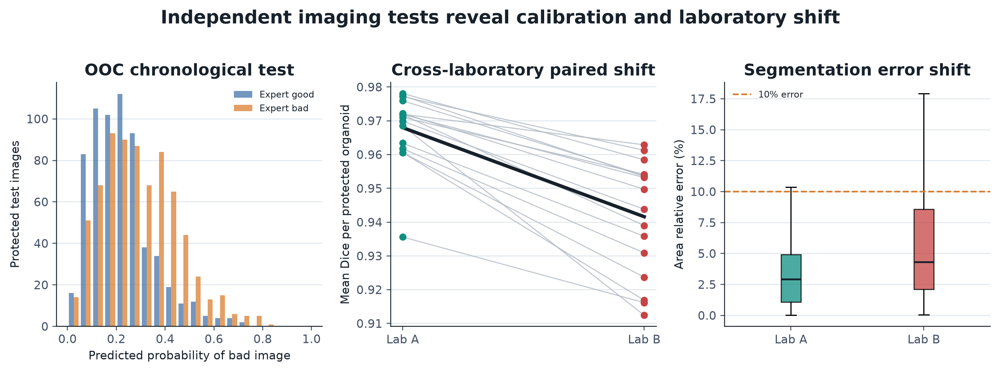

<p class="caption"><strong>Figure 12.</strong> Independent imaging diagnostics. Left: OOC probability distributions overlap substantially under chronological shift. Center: paired Dice decreases from Lab A to Lab B for every protected organoid. Right: area error increases in the external laboratory.</p>

The Lab-A-only model reaches 0.968 mean Dice in Lab A and 0.942 in Lab B. It beats the published multi-lab SegFormer in Lab A by 0.0079 Dice across the 16 protected organoids, then loses in Lab B by 0.0181 Dice with 0 of 16 wins (exact paired p=0.000031). Images above 10% area error increase from 6.25% to 22.73%. Pixel and test-time-augmentation uncertainty accepts 99.4% of Lab-B images and fails as a shift safeguard. A post-hoc acquisition fingerprint flags all Lab-B images, but because it was created after observing the failure it is labeled secondary evidence and releases none.

The imaging results reinforce the release philosophy: a model can rank examples or segment images reasonably well while thresholded automation remains unsafe under a new date or laboratory.

## 14 System implementation

### 14.1 Repository structure

The implementation separates model logic, evidence, audit code, protocols, figures, and report generation:

- `src/gates/act` contains response models, acquisition policies, stopping logic, and imaging audits;
- `scripts` contains data verification, frozen replay, report generation, and independent recomputation;
- `artifacts/act/canonical` contains pooled evidence and protected predictions;
- `artifacts/act_v3` contains source-specific frozen traces and stopping locks;
- `protocols` records eligibility, decision, and external-confirmation contracts; and
- `tests` checks policy behavior, split isolation, safety rules, and audit consistency.

### 14.2 Fail-closed decision flow

The runtime order is fixed:

1. validate the source manifest and group boundary;
2. construct the current chronological candidate set;
3. condition the response model on observed cells;
4. select a batch using the frozen acquisition policy;
5. recompute effect protection and shift quantities;
6. apply the exact release gate; and
7. emit COMPLETE or ABSTAIN while STOP remains unauthorized.

Missing fields, changed hashes, incomplete policy coverage, numerical conditioning failure, or an unlocked stop configuration produce an audit failure rather than a fallback decision.

### 14.3 Computational profile

The response surfaces are small enough for direct covariance conditioning. Within-batch greedy selection requires repeated linear solves on the observed block; the dominant cost grows cubically with observed-cell count in the unoptimized formulation. Because dose-time grids are compact, this cost is negligible relative to assay acquisition. The implementation favors transparent deterministic computation over approximate large-scale optimization.

## 15 Reproducibility and verification

```bash
uv sync --frozen --extra dev
uv run python scripts/verify_gates_act_v3_sources.py
uv run python scripts/audit_gates_act_core.py
uv run python scripts/verify_gates_act_core.py
uv run python scripts/audit_gates_act_vision.py
uv run pytest
uv run python scripts/build_submission_report.py
```

The core verifier checks source hashes, the 76-group boundary, policy coverage, pooled metrics, paired comparisons, the exact stopping bound, and the disabled-stop action. The vision verifier recomputes protected metrics and dataset hashes. Report figures are generated directly from canonical CSV and JSON artifacts, not manually transcribed values.

| Verification layer | Scope | Status |
|---|---|---|
| Source manifest | Four public MEA archives and hashes | Pass |
| Core evidence | 76 groups, five policies, pooled metrics | Pass |
| Stopping lock | Exact upper bound and released action | Pass, STOP disabled |
| Imaging audit | OOC and organoid protected metrics | Pass |
| Unit and integration tests | Models, policies, audits | Pass |
| Static analysis | Python source and builders | Pass |
| PDF inspection | Text and rendered pages | Final build gate |

## 16 Limitations

1. **Retrospective design.** The acquisition policies are replayed on complete historical datasets. A prospective wet-lab intervention is still required.
2. **No physical savings.** STOP is disabled, so no recording session has been prospectively avoided.
3. **Conservative precision.** Effect protection produces low positive precision under source shift. High recall is not accurate positive classification.
4. **Source heterogeneity.** Policy ordering differs on the six-group Brown set. The pooled choice is driven primarily by the larger Tipping confirmation.
5. **Finite group count.** Seventy-six groups remain limited for rare failure modes.
6. **Exchangeability assumption.** The stopping bound is meaningful only if validation stops are independent and relevant to deployment.
7. **Endpoint scope.** Mean firing rate is one neural electrophysiology endpoint. Other MEA features require separate validation.
8. **Imaging separation.** OOC quality and organoid segmentation are independent stress tests, not paired predictors of MEA response.
9. **Post-hoc shift detector.** The organoid acquisition fingerprint followed the Lab-B failure and is not untouched validation.
10. **Evidence boundary.** Incompatible or order-ambiguous archives are excluded rather than coerced into the estimand.

## 17 Prospective validation plan

The next study should operate in shadow mode on complete plates. Every recommendation must be logged before corresponding future measurements are observed. The plate is still completed, enabling an unbiased unsafe-stop label. Validation groups should be independent compound runs spanning laboratories, acquisition dates, vehicle contexts, and response magnitudes.

Release review should occur only after at least 59 independent zero-failure candidate stops or the larger sample implied by any observed failures. The review must recompute the exact upper bound, inspect source-specific failure rates, and confirm that the deployment population remains inside the calibration boundary. A successful release would authorize omission of a future whole session, not retrospective deletion of already acquired wells.

## 18 Conclusion

GATES-ACT demonstrates that adaptive measurement and experimental stopping must be evaluated separately. Conditional maximum variance provides the strongest pooled external acquisition result: 97.87% protected recall, the lowest hidden-response NRMSE, and significant improvements over fixed and random baselines. The more elaborate effect-weighted rule does not justify its added complexity. External stopping evidence is unfavorable, so the released system refuses autonomous termination and claims no physical savings.

This combination of positive and negative results defines the project’s technical contribution. The model improves measurement selection, the evidence design reveals where that improvement holds, and the release gate prevents unsupported automation. The resulting system is suitable for retrospective replay and prospective shadow deployment, with a concrete finite-sample path toward future stopping authority.

## Appendix A Metric definitions

Let (H_g\) be the cells hidden at the current round and (A_g\subseteq H_g\) the truly affected hidden cells.

$$
\operatorname{NRMSE}_g=
\frac{\sqrt{|H_g|^{-1}\sum_{c\in H_g}(\hat y_c-y_c)^2}}
{\max(y_g)-\min(y_g)+\epsilon}.
$$

$$
\operatorname{Recall}_g=\frac{|A_g\cap P_g|}{|A_g|},\qquad
\operatorname{Precision}_g=\frac{|A_g\cap P_g|}{|P_g|}.
$$

$$
\operatorname{Capture}_g=\frac{|A_g\cap O_g|}{|A_g|}.
$$

Metrics with an empty affected-cell denominator are handled by the frozen audit contract and are not silently converted into positive evidence.

## Appendix B Paired comparison table

| Comparator | Metric | Difference for max variance | 95% interval | p value |
|---|---|---:|---:|---:|
| Effect weighted | Recall | +0.00399 | -0.00600 to +0.01316 | 0.4272 |
| Effect weighted | NRMSE | -0.00750 | -0.01520 to -0.00066 | 0.0464 |
| Maximin | Recall | +0.00508 | -0.00442 to +0.01507 | 0.3458 |
| Maximin | NRMSE | -0.01862 | -0.03611 to -0.00471 | 0.0106 |
| Fixed sentinels | Recall | +0.02459 | +0.00940 to +0.04078 | 0.00187 |
| Fixed sentinels | NRMSE | -0.01379 | -0.02508 to -0.00334 | 0.0120 |
| Random | Recall | +0.01666 | +0.00477 to +0.02858 | 0.00318 |
| Random | NRMSE | -0.02702 | -0.04471 to -0.01289 | <0.0001 |

Positive recall and negative NRMSE differences favor maximum variance.

## Appendix C Release checklist

| Requirement | Current evidence | Decision |
|---|---|---|
| Source hashes match | Verified | Pass |
| Compound groups isolated | 76 of 76 complete | Pass |
| Policy coverage complete | Five policies per group | Pass |
| Maximum variance selected without external retuning | Frozen baseline adopted | Pass |
| Unsafe-stop upper bound at most 5% | 98.3% | **Fail** |
| Minimum zero-failure stops | 59 required | Not met |
| Physical sessions prospectively avoided | 0 | None claimed |
| Imaging automatic-pass risk below 5% | No nonzero region | Withhold |
| Uncalibrated laboratory release | Shift observed | Abstain |

## Data availability

The report uses public datasets identified by DOI in the references. The repository stores source manifests, byte counts, and cryptographic hashes rather than redistributing the complete raw archives. Canonical derived metrics, protected predictions, source-specific traces, and split audits are versioned with the report so every displayed figure can be regenerated from inspectable evidence.

## Code availability

The model, acquisition policies, audit programs, tests, figure generator, and report builder are available in the accompanying GATES repository. The report build is deterministic given the pinned environment and canonical artifacts. Raw-source acquisition remains a separate explicit step because several archives have independent license and distribution terms.

## Responsible use statement

GATES-ACT is a research system for retrospective replay and prospective shadow evaluation. It is not authorized to terminate experiments, certify compound safety, or replace expert review. The release action remains COMPLETE or ABSTAIN until prospective candidate stops satisfy the exact risk gate. Imaging modules similarly withhold automatic passage under chronological or laboratory shift.

## References

1. NTP EPA Phase 1 DNT MEA curated release. https://doi.org/10.22427/NTP-DATA-500-018-001-000-5
2. Brown et al. neural network ontogeny MEA data. https://doi.org/10.23719/1412682
3. EPA Tipping Point determinations. https://doi.org/10.23719/1407690
4. Vassallo multi-laboratory acute MEA archive. https://doi.org/10.23719/1517583
5. Shafer TJ et al. Developmental neurotoxicity assay using cortical network formation. *Toxicological Sciences*. https://doi.org/10.1093/toxsci/kfz052
6. Vassallo A et al. MEA neural network activity for acute neurotoxicity testing. *NeuroToxicology*. https://doi.org/10.1016/j.neuro.2016.03.019
7. Giraldo Gutierrez P et al. Multi-output Gaussian-process modeling. *npj Precision Oncology*. 2024. https://doi.org/10.1038/s41698-024-00685-1
8. D'Souza M et al. Active kernelized matrix completion. *BMC Bioinformatics*. 2015. https://doi.org/10.1186/s12859-015-0713-8
9. Kontoudis GP, Stilwell DJ. Expected integrated variance reduction. *American Control Conference*. 2023. https://doi.org/10.23919/ACC55779.2023.10155994
10. OOC Image Dataset. Zenodo. https://doi.org/10.5281/zenodo.10203721
11. OOC quality classification study. *Data*. https://doi.org/10.3390/data9020028
12. Cross-laboratory brain-organoid images. Zenodo. https://doi.org/10.5281/zenodo.10301912
13. Brain-organoid monitoring dataset. *Scientific Data*. https://doi.org/10.1038/s41597-024-03330-z
